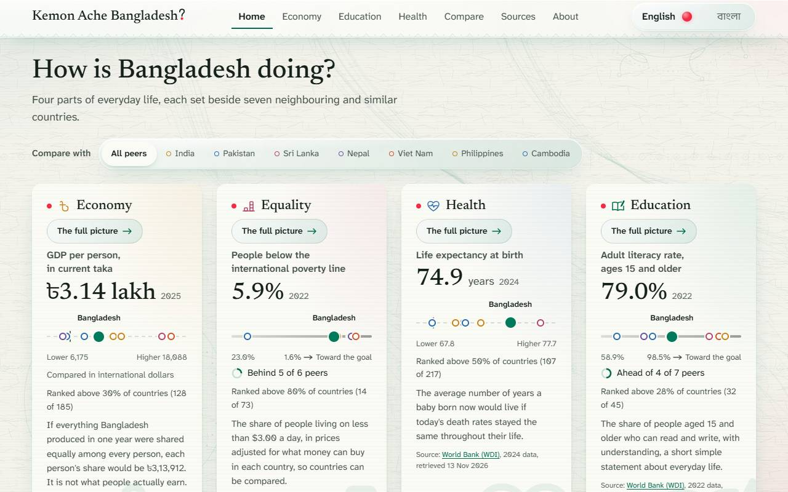
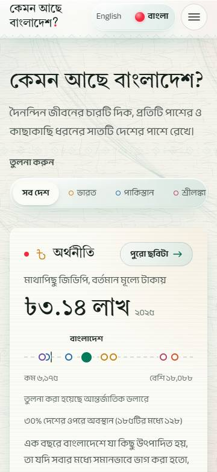
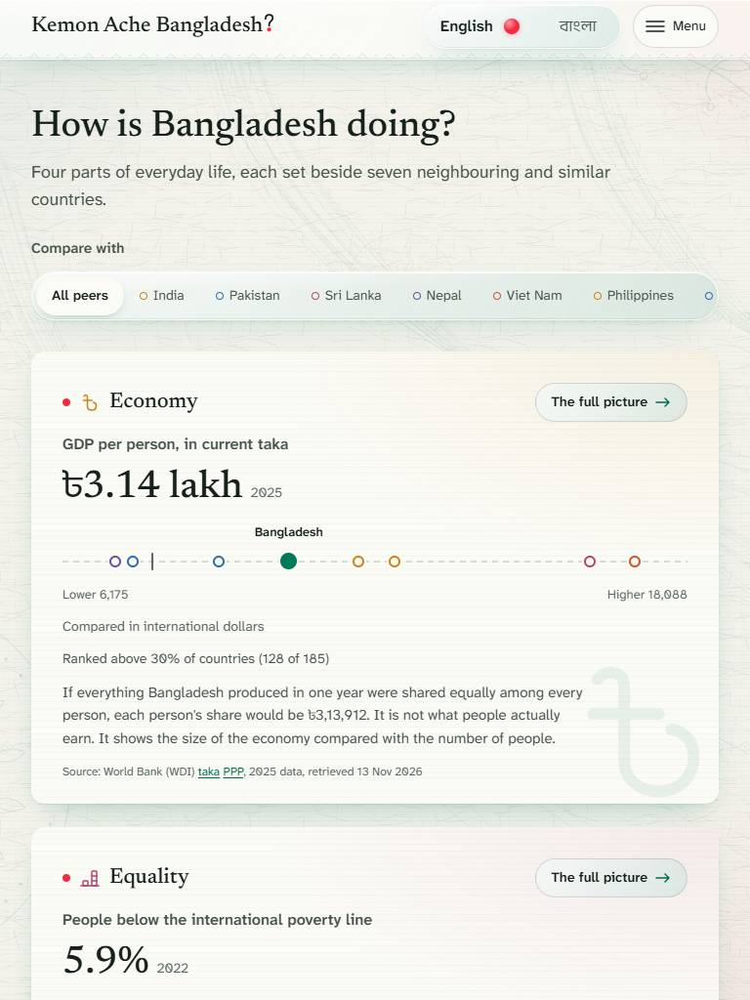
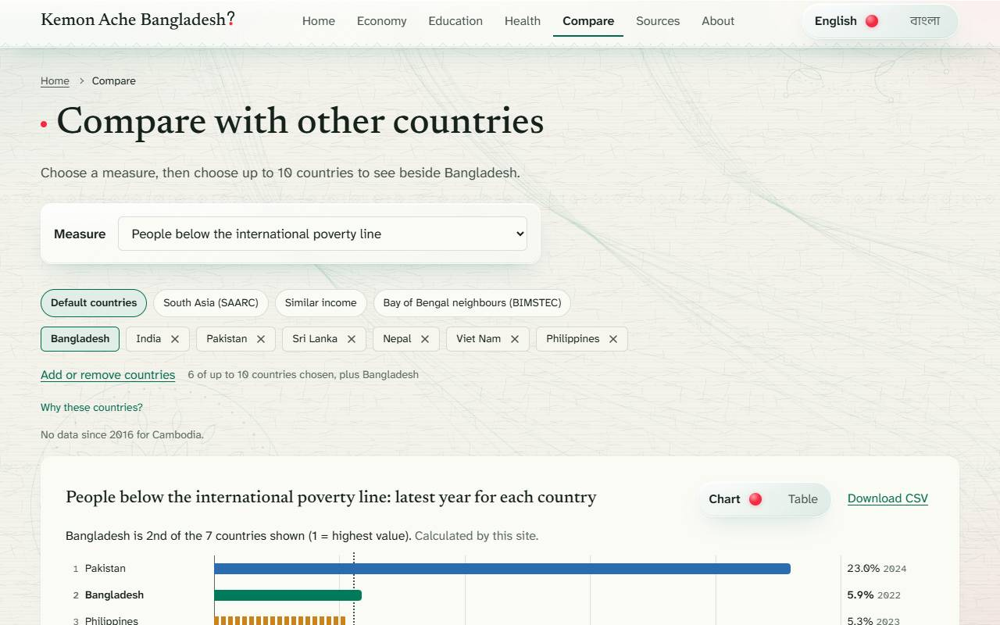

# Kemon Ache Bangladesh? (কেমন আছে বাংলাদেশ?)

**How is Bangladesh doing? A bilingual dashboard of real published data, in plain words.**

**[Open the live site](https://ahmar-biswas.github.io/kemon-ache-bangladesh/)** · [English](https://ahmar-biswas.github.io/kemon-ache-bangladesh/en/) · [বাংলা](https://ahmar-biswas.github.io/kemon-ache-bangladesh/bn/)



GDP counts only production, and the Human Development Index covers health and education with a few narrow measures. Most of the data that describes everyday life in Bangladesh sits in English research papers and official tables that an ordinary person cannot easily read.

This site puts the key measures of economy, poverty and inequality, education and health in one place. Each number is explained in simple language, compared with similar countries, and linked to the page it came from. It is built for people on a phone with limited data, and it works in English and Bangla.

## What you can do on it

- **See the headline numbers at a glance.** The homepage shows one headline for each of four areas: Economy, Poverty and inequality, Education and Health.
- **Compare Bangladesh with other countries.** Pick up to 10 of 217 countries, or use presets (SAARC, BIMSTEC, similar income). Each country's own data year is shown, so different years are never silently compared.
- **Follow a measure over time.** Lines start at the first published year, gaps are kept, and 16 sourced events (elections and shocks) are marked.
- **Check the source for anything.** Every figure has its source, a link to the exact dataset, the data year and the date it was retrieved directly beneath it. The Sources page lists every data point.
- **Switch language.** Every page is available in English and Bangla, with Bangla numerals and lakh/crore grouping in Bangla mode.

## Principles

1. **No source, no display.** A value without a source link does not render, and the build fails if one slips through.
2. **Real data only.** Nothing is estimated, interpolated, smoothed or forecast. Missing data reads "Data not available".
3. **No composite score.** The site never ranks countries by "well-being". Any derived number (a rank, a median) is labelled "Calculated by this site" with its inputs.
4. **Neutral language.** It uses "higher than" and "lower than", never "good" or "bad", and colour is never used to judge a number.
5. **Explanations are definitions only.** They say what a measure means, and link to its official definition.

## Data

All numbers come from public sources and are stored with their provenance.

- **World Bank World Development Indicators:** 41 series covering GDP per person (in taka), inflation, jobs, remittances, reserves, poverty lines, the Gini index, income shares, literacy, school enrolment, life expectancy, child and maternal mortality, stunting, vaccination, doctors, hospital beds, health spending, electricity, safe water and air quality. This includes WHO, UNESCO and UNICEF figures as the World Bank republishes them.
- **Six published rankings,** shown in "Bangladesh at a glance": the SDG Index, Press Freedom, Global Hunger, HDI, World Happiness and Corruption Perceptions.
- **Verification:** 20 randomly chosen displayed values were re-fetched from the World Bank API, and all 20 matched exactly ([docs/VALUE_CHECK.md](docs/VALUE_CHECK.md)). Indicators that failed checks are listed with the reason in [DROPPED_INDICATORS.md](DROPPED_INDICATORS.md).

## How it is built

- **Static site:** Vite, React and TypeScript. Every page is pre-rendered to HTML in both languages (96 pages), so text, tile values and the language switch work even without JavaScript.
- **Data pipeline:** `npm run data:refresh` downloads each series, normalises it into small records with full provenance, and validates it. It checks that the unit is unchanged, values are in a plausible range, no year goes backwards, every record has a source link, and no more than 20% of old values changed. It is all or nothing: if any check fails, no data file changes.
- **Automatic refresh:** a GitHub Actions job runs every Monday, validates the new data, and publishes only if every check passes. On failure the last good data stays up, the site says the latest check could not be completed, and an issue is opened.
- **Hosting:** GitHub Pages, free.
- **Charts and design:** custom, with a design system inspired by Bangladesh: a river-delta background, kantha stitch dividers, and a language switch styled as the flag. Fonts are self-hosted and glass effects fall back to plain paper on low-end devices.

## Quality

- **992 automated tests,** including a check that every displayed value has a source link, a data year and a retrieved date in both languages.
- **A crawler** opens every page in both languages in Chrome and fails on a missing source line, missing translation, broken link or judgement word.
- **Accessibility:** no WCAG 2.1 AA violations found by axe at desktop and phone widths, keyboard navigation checks, and Lighthouse accessibility 97–100.
- **Performance:** about 153 KB of gzipped JavaScript on the homepage, built mobile-first for a 360 px phone.
- **Translation:** all 847 Bangla strings are listed next to their English in [BANGLA_REVIEW.md](BANGLA_REVIEW.md) and were reviewed by the author.

## Screenshots

| Phone (Bangla) | Tablet | Compare |
|---|---|---|
|  |  |  |

## Run it locally

You need Node.js 22 or newer.

```bash
git clone https://github.com/ahmar-biswas/kemon-ache-bangladesh.git
cd kemon-ache-bangladesh
npm install
npm run dev
```

| Command | What it does |
|---|---|
| `npm run dev` | Starts the site locally |
| `npm run check` | Type check, translation check, data check and tests |
| `npm run build` | Builds and pre-renders the site into `dist/` |
| `npm run check:crawl` | After a build, crawls every page in both languages |
| `npm run data:refresh` | Downloads and validates the latest data (takes several minutes) |

More detail on adding a measure, updating Bangla text and handling a failed refresh is in [docs/CONTRIBUTING.md](docs/CONTRIBUTING.md). Design decisions and their reasons are in [DECISIONS.md](DECISIONS.md), and field definitions are in [DATA_DICTIONARY.md](DATA_DICTIONARY.md).

## Project status

Version 1 is live. It covers Economy, Poverty and inequality, Education and Health. Crime, environment, budget treemaps and district-level data are planned for later, and only where reliable published data exists. Progress is tracked in [docs/PROGRESS.md](docs/PROGRESS.md).

## About

Built by [Ahmar](https://github.com/ahmar-biswas), a BBA student at the Institute of Business Administration (IBA), University of Dhaka, focused on finance, economics and data analytics. This is a data-analytics portfolio project, built with Claude Code.

Feedback and corrections are welcome, especially on Bangla wording. Please open an issue and include a source link for anything about the data.
